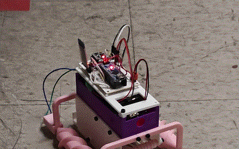
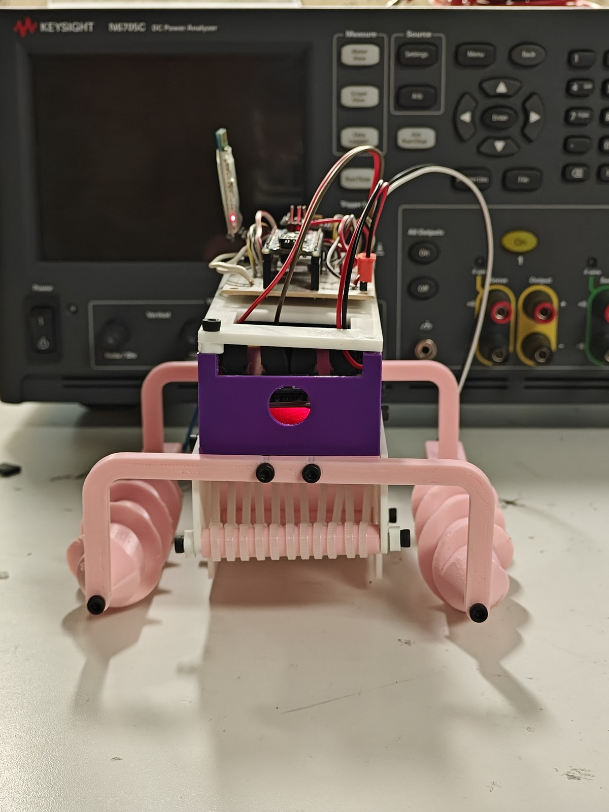
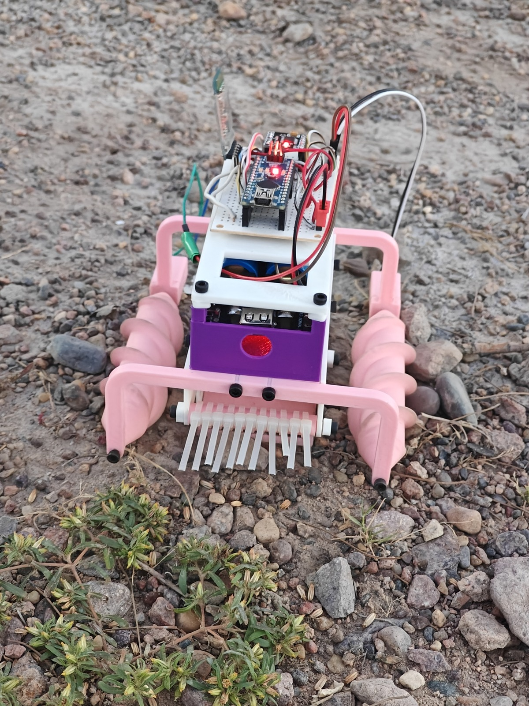
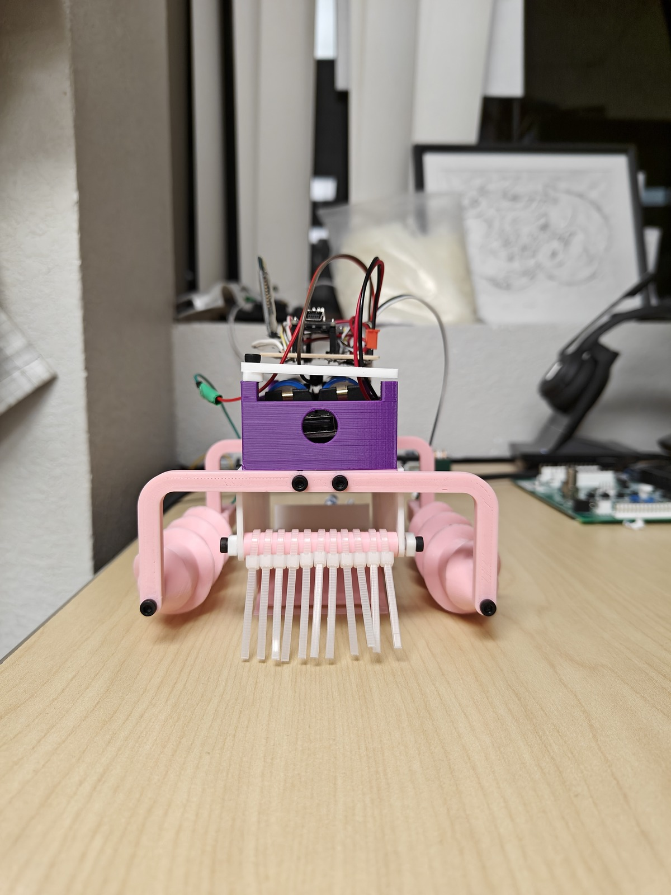
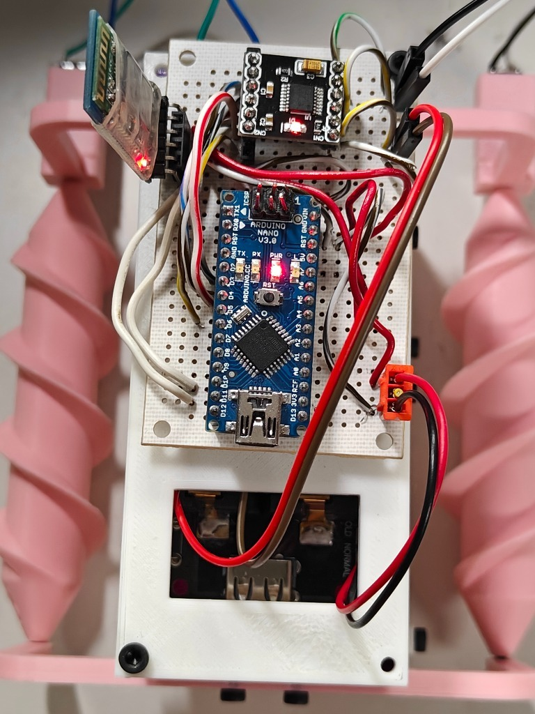
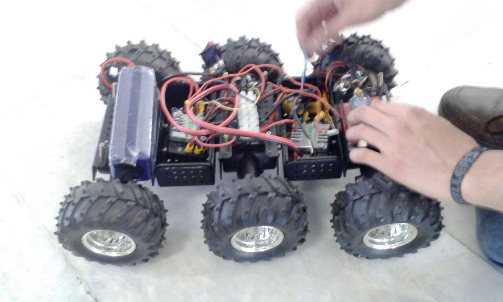
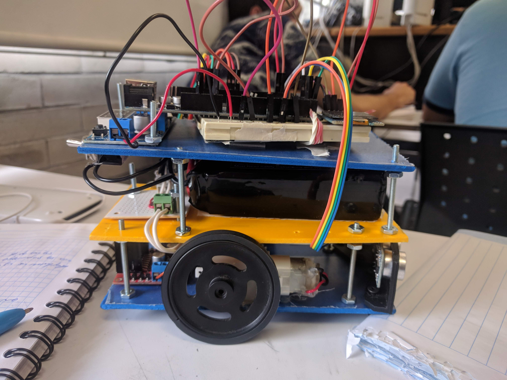

# 🌊 Conceptual Design of a Beach Waste Collection System

**Bachelor’s Thesis — Mechatronics Engineering**  
**Universidad Nacional Autónoma de México (UNAM) — Faculty of Engineering**  
**Advisor:** Dr. Alejandro Cuauhtémoc Ramírez Reivich  
📍 Ciudad Universitaria, 2024

---

## 📌 Description

This repository contains documentation, CAD models, embedded software, and test media related to the undergraduate thesis: the **conceptual design of a robotic beach-cleaning machine**.  
The project proposes a solution to the growing issue of waste pollution on coastal granular areas, focusing on:

- Conceptualization of a non-autonomous, teleoperated mechatronic prototype
- Mobility design over granular terrain (sand) using **helical Archimedes screw-drive pontoons**
- Effective waste collection via front-mounted flexible rake sifters and gathering mechanisms
- Parametric 3D CAD modeling, 3D-printed rapid fabrication, and embedded power/actuation testing

---

## 🌪️ Archimedes Screw-Drive Physical Prototype & Test Run

The physical proof-of-concept integrates dual counter-rotating Archimedes screw pontoons for holonomic/skid propulsion across loose sand and granular ground, an integrated front rake sifter, and an onboard Arduino Nano microcontroller with wireless Bluetooth teleoperation.

| Front Lab Assembly (Keysight DC Power Analyzer) | Granular Sand & Outdoor Terrain Testing |
|:---:|:---:|
|  |  |

| Sifter Rake Comb Detail | Embedded Control Deck (Arduino Nano + BT) |
|:---:|:---:|
|  |  |

---

## 🔬 Early Mobility & Chassis Iterations

### Mobile Rover Physical Prototype (Beach Cleaner)

### Hardware & Chassis Prototype Builds

### Final Assembly — Scooping Mechanism with Custom Rollers

---

## 📑 Final Thesis Document

📄 [Download Full Thesis (PDF)](http://132.248.9.195/ptd2024/oct_dic/0863947/Index.html)

---

## 📜 License

This repository is shared for educational and documentation purposes. All materials are original work by the author unless stated otherwise.
